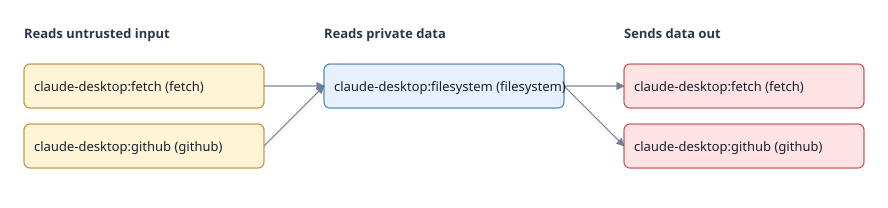

# toolvet

Find dangerous combinations of AI agent tools (MCP servers) before attackers do, and pin what you approved so silent changes fail CI.

Every MCP server you install can look safe on its own. toolvet shows what they can do **together**.



*One agent session, three servers that each pass review alone: a web fetcher reads untrusted content, a filesystem server reads private files, and a GitHub or fetch tool can send data out. toolvet reports the source-to-sink path.*

## Why

Two attacks matter most when you give an agent tools:

- **The lethal trifecta.** One agent holds a tool that reads untrusted content (web pages, email, issues), a tool that reads private data (files, secrets, databases) and a tool that sends data out (HTTP, email, git push). An instruction hidden in a web page can then exfiltrate private data. The danger exists only in the combination.
- **The rug pull.** A server ships a harmless tool description, you approve it, and a later update quietly changes the description or schema. Nothing asks you again.

## Install

```bash
pipx run toolvet scan          # run once, nothing installed
pipx install toolvet           # or install the command
pip install 'toolvet[ml]'      # with the optional local classifier
```

Requires Python 3.11+. To work on toolvet itself: clone the repo, then `uv sync && uv run toolvet scan`.

## Use

```bash
toolvet scan [path]      # discover servers, run rules, build the graph, report
toolvet lock             # write agent.lock
toolvet verify           # compare with agent.lock; exit 1 on any change
toolvet snapshot --introspect   # opt in: launch servers and record their real tools
toolvet graph --format mermaid|svg
```

`scan` runs fully offline and never executes anything. It exits 1 if any finding is at least `--fail-on` (default `high`).

### Pin what you approved

```bash
toolvet snapshot --introspect   # asks before running each configured server
toolvet lock                    # hashes servers and every tool's name, description, schema
git add agent.lock agent.tools.json && git commit
# in CI:
toolvet verify
```

`agent.lock` is reviewed in pull requests like any lockfile. Environment variable **values** are never stored or hashed; only their names are.

MCP configs only say how to launch a server, not what tools it exposes. Without a snapshot, `lock` pins each server's launch definition but not its tool descriptions, and `lock` tells you so. Introspection runs the commands from your own config, exactly as your MCP client does. It is not a sandbox.

## In CI

Use the GitHub Action. It scans, writes a SARIF report, and runs `verify` when `agent.lock` exists:

```yaml
name: toolvet
on: [push, pull_request]
permissions:
  contents: read
  pull-requests: write     # for the pull request comment
  security-events: write   # only needed for upload-sarif
jobs:
  audit:
    runs-on: ubuntu-latest
    steps:
      - uses: actions/checkout@v4
      - uses: AbdulRehman19-bit/toolvet@v0.7.0
        with:
          fail-on: high
          upload-sarif: "true"   # shows findings in the Security tab
```

The action installs toolvet from the tagged action source, so the version you pin is the version that runs.

Other report formats: `toolvet scan --format json|sarif|markdown|badge [-o file]`.

### Review what a pull request changes

A scanner tells you whether your setup is risky now. `toolvet diff` tells you whether **this change** makes it riskier:

```bash
toolvet diff --base origin/main          # compare the working tree with a git ref
toolvet diff --base v1.0 --head HEAD     # or two refs
```

It reads the configs straight from git (nothing is checked out or run) and reports servers added, removed or changed, capabilities gained or lost, tool description changes, findings introduced or resolved, and whether a lethal trifecta is created, widened or removed. It exits 1 if the change adds a finding at or above `--fail-on`, or creates or widens a trifecta.

On pull requests the GitHub Action runs it automatically, writes the report to the job summary, and keeps **one comment** up to date. Real output for a PR that adds a mail server:

> ### NEW lethal trifecta
>
> In `.mcp.json`. Servers involved: `mcp:mailer`, `mcp:postgres`, `mcp:web-search`
>
> Untrusted input can reach private data and a channel that sends data out.
>
> Smallest fixes:
>
> - Drop or move the server(s) this change adds (`mcp:mailer`): without them there is no trifecta.
> - Move `mcp:web-search` to a separate agent profile (or remove it). It is the only server here that reads untrusted input, so nothing in this config reads untrusted input afterwards.
> - Move `mcp:postgres` to a separate agent profile (or remove it). It is the only server here that reads private data, so nothing in this config reads private data afterwards.
>
> | Severity | Rule | Where | Message |
> |---|---|---|---|
> | high | TV002 | `mcp:mailer` | `Env var SMTP_PASSWORD holds a literal secret in the config; reference it instead` |
> | medium | TV003 | `mcp:mailer` | `Package mcp-server-smtp is not pinned to a version` |
>
> ### Servers added
>
> - `mcp:mailer` runs `uvx mcp-server-smtp`; capabilities: `sink via 'smtp'`

Everything that comes from a pull request's files (server names, tool descriptions, arguments) is placed inside code spans or blocks, so a malicious description cannot inject links, HTML or `@mentions` into the comment, and credential-looking arguments are masked. Fork PRs get a read-only token, so for them the job summary is the report.

### Badge

```bash
toolvet scan --format badge -o docs/toolvet.svg
```

```markdown

```

Commit the SVG and regenerate it in CI. It shows `passing`, a count of low-risk findings, or a count of issues at or above `--fail-on`.

## What it checks

| Rule | Severity | Finds |
|---|---|---|
| TV001 | high | Server launched through a shell, or named like a shell tool |
| TV002 | high | Literal secrets in `env` |
| TV003 | medium | Unpinned `npx` / `uvx` / `pipx` packages |
| TV004 | high | Root or wildcard paths (`/`, `~`, `C:\`, `/home/*`) |
| TV005 | medium | Plain `http://` remote servers |
| TV006 | high | Instruction-like text in tool descriptions (needs tool data) |
| TV007 | high | Credentials in a server URL |
| TV008 | high | Credentials in command-line arguments |
| TV009 | high | Download-and-execute launch commands |
| TV010 | high / medium | Privileged containers, host root or Docker socket mounts, host network |
| TV100 | critical | Lethal trifecta: untrusted source, private data and sink in one config |

Supported configs: Claude Desktop, Cursor, VS Code (`.vscode/mcp.json`) and a generic `.mcp.json`.

## Waivers and policy

Accept a finding once, with a name and an expiry date, instead of switching the check off. `agent.policy.toml` lives in your repo:

```toml
fail_on = "high"

[[waiver]]
rule = "TV100"            # lethal trifecta: list exactly the servers you reviewed
servers = ["mcp:fetch", "mcp:filesystem", "mcp:github"]
reason = "agent runs in a container with no real data mounted"
owner = "bob"
expires = 2027-01-15
```

- Every waiver needs a **reason, an owner and an expiry**; expired waivers stop applying and the finding returns.
- A trifecta waiver covers **only the servers you listed**. Add a server and it no longer applies, so a widened trifecta cannot slip through.
- Waived findings stay in the report (and in SARIF as suppressions) with their reason.
- **A pull request cannot waive its own risk:** `diff` applies the base branch's policy, and lists any waivers the PR adds for a reviewer to approve.
- `toolvet policy check` reports expired, soon-to-expire and unused waivers.

Details: [docs/policy.md](https://github.com/AbdulRehman19-bit/toolvet/blob/main/docs/policy.md).

## Optional: local ML classifier

A small ONNX model (20 KB) scores tool descriptions for prompt-injection and exfiltration wording. It runs on your machine, sends nothing anywhere, and is **advisory**: its findings are labelled `advisory` and never fail CI.

```bash
pip install 'toolvet[ml]'
toolvet snapshot --introspect     # the classifier needs real tool descriptions
toolvet scan --classify
```

Measured accuracy, with the caveats that matter, is in [docs/classifier.md](https://github.com/AbdulRehman19-bit/toolvet/blob/main/docs/classifier.md). In short: on held-out synthetic data the false-positive rate is 0.8%, but on a small hand-written set closer to real descriptions it is **11.4%** (95% interval 4.5% to 26%). The training data is synthetic, so treat it as a second opinion next to the deterministic rules. A real-world false-positive rate has not been measured yet.

## How the trifecta check works, and its limits

**Fixes, not just alarms.** Every trifecta finding lists the smallest fixes. Within one config, a trifecta exists exactly when all three layers (untrusted source, private data, sink) are present, so the cheapest fix is whichever layer the fewest servers supply: take those servers out of the config, or move them to a separate agent profile, and every path is broken. This is exact, not a heuristic (it is tested against exhaustive search). It also says when moving does not help: a server that can do all three on its own, such as a mail server that reads, stores and sends, has to be restricted or removed. In pull request comments, the first suggestion is the fewest servers *this change adds* whose removal makes the trifecta disappear.

Capability tags come from a fixed keyword table ([capabilities.py](https://github.com/AbdulRehman19-bit/toolvet/blob/main/src/toolvet/capabilities.py)) matched against each server's name, command, arguments, URL host and tool names. There is no inference, and every finding prints the keyword behind each tag, so you can check it line by line.

That makes it explainable, but not precise:

- A server is tagged by keyword, not by what it actually does. Expect false positives (a server with "search" in its name counts as untrusted input) and false negatives (an unrecognised server gets no tags).
- **Most servers are not recognised, so "no findings" does not mean "safe".** When tested on 137 servers from 83 popular public repos, the table recognised 36% of them (50 of 137). Everything else gets no tags and can never take part in a trifecta. Treat a clean scan as "nothing recognised", and add tags for servers you use (see CONTRIBUTING).
- Launch wrappers such as `cmd /c npx ...` and `bash -c "exec npx ..."` are seen through, so the wrapped command is what gets checked and tagged. A shell running anything more than one simple command is still treated as a real shell.
- Servers combine only when they live in the same config file, which is treated as one agent session.
- Findings are heuristic. Treat TV100 as "look at this", not proof of a vulnerability.

## How it compares

toolvet is not the first MCP scanner, and the trifecta idea is not new. The closest tool is [Snyk Agent Scan](https://github.com/snyk/agent-scan) (formerly Invariant Labs' `mcp-scan`), which does cross-tool "toxic flow" analysis using the same lethal-trifecta framing. If you want broader coverage (agent skills, 14+ risk types, hosted analysis), use it.

What toolvet does differently, based on both projects' public READMEs and blog posts as of 2026-11-04 (check their current docs; "not documented" below does not mean "absent"):

| | toolvet | Snyk Agent Scan |
|---|---|---|
| Network | Offline by default; nothing leaves your machine | Needs a `SNYK_TOKEN`; sends tool names, descriptions and server config signatures to Snyk's API (secrets redacted); no local-only mode documented |
| Running servers | `scan` never executes anything; `snapshot --introspect` asks first | Starts stdio servers (per-server consent by default) |
| Cross-tool flow analysis | Yes: fixed keyword table, source to private data to sink within one config, every hop explained | Yes: flow graph with trust, sensitivity and sink properties; part of the analysis runs through their API |
| Approval pinning | `agent.lock` is committed to your repo and reviewed in pull requests; `verify` fails CI | The original MCP-Scan pinned tool hashes; the current README does not document it, and its state file defaults to `~/.mcp-scan` |
| CI output | SARIF, JSON, Markdown, badge, GitHub Action | `--ci` exit code and `--json`; SARIF and an Action are not documented in the README |
| Fix suggestions | Smallest set of servers to remove or move to break each trifecta (exact), and in PRs the servers the change adds | Not documented in the README |
| Accepting risk | Waivers in `agent.policy.toml`: reason, owner, expiry, exact server set; a PR cannot waive itself | Not documented in the README |
| Extending | Python entry-point rule plugins | Plugins not documented; the README says it does not accept external contributions |
| Licence | MIT | Apache-2.0 |

There is also [agent-audit](https://github.com/HeadyZhang/agent-audit) (PyPI `agent-audit`, MIT), a separate project (this one used to be called `agentaudit` before a rename to avoid confusion with it). It is broader in one direction: it analyses agent **source code** (taint tracking from tool parameters to dangerous sinks) as well as MCP configs, and it has SARIF output, a GitHub Action, a baseline mode (`--fail-on-new`) and ignore rules with a reason. Going by its README, it does not do lethal-trifecta analysis across servers, a hashed lockfile, capability diffs on pull requests, or waivers with an owner and an expiry date. Those are what this project adds, and it does not read your agent's source code. The two tools are complementary, and you can run both.

In short: this project's bet is **offline, deterministic and explainable, with approvals that live in version control**. That is a narrower tool, not a better one for every case.

## Writing a rule

A rule is a function from one server to findings. See [CONTRIBUTING.md](https://github.com/AbdulRehman19-bit/toolvet/blob/main/CONTRIBUTING.md); a first rule takes about ten minutes.

## Status

Pre-release. v0.2 added SARIF/JSON/Markdown/badge output and a GitHub Action; v0.3 adds the opt-in local classifier. See [docs/DESIGN.md](https://github.com/AbdulRehman19-bit/toolvet/blob/main/docs/DESIGN.md).

## Licence

MIT
