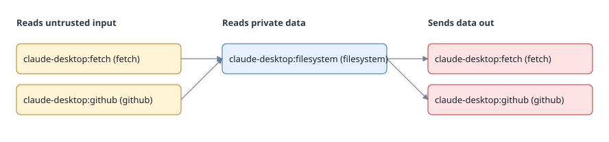

# agentaudit

Find dangerous combinations of AI agent tools (MCP servers) before attackers do, and pin what you approved so silent changes fail CI.



## Quick start

```bash
git clone https://github.com/AbdulRehman19-bit/agentaudit
cd agentaudit && uv sync
uv run agentaudit scan /path/to/your/repo
```

agentaudit is not on PyPI yet.

## Guides

- [Rules reference](rules): what each rule finds and how to fix it
- [Using it in CI](ci): the GitHub Action, SARIF and lockfile verification
- [Policy and waivers](policy): accept risk with an owner and an expiry date
- [Classifier accuracy](classifier): the optional ML classifier and how well it works
- [Contributing](https://github.com/AbdulRehman19-bit/agentaudit/blob/main/CONTRIBUTING.md): write a rule in ten minutes

## The two attacks

**The lethal trifecta.** One agent holds a tool that reads untrusted content, a tool that reads private data and a tool that sends data out. A hidden instruction in a web page can then exfiltrate private data. Each server passes review alone; the danger is in the combination.

**The rug pull.** A server ships a harmless tool description, you approve it, and a later update changes it. `agentaudit lock` records hashes and `agentaudit verify` fails when anything drifts.

## How it compares

Snyk Agent Scan (formerly `mcp-scan`) also analyses cross-tool flows. agentaudit is the offline, deterministic option whose approvals live in your repo. See the [comparison table](https://github.com/AbdulRehman19-bit/agentaudit#how-it-compares).

## Principles

- `scan` runs offline and never executes anything.
- Nothing leaves your machine unless you opt in.
- Every capability tag names the keyword behind it, so findings can be explained line by line.
- Heuristic signals never fail CI on their own.
